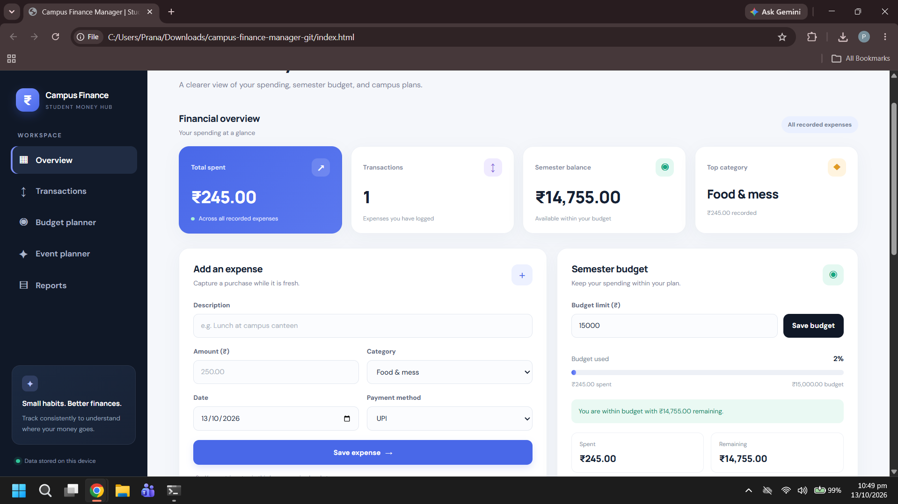
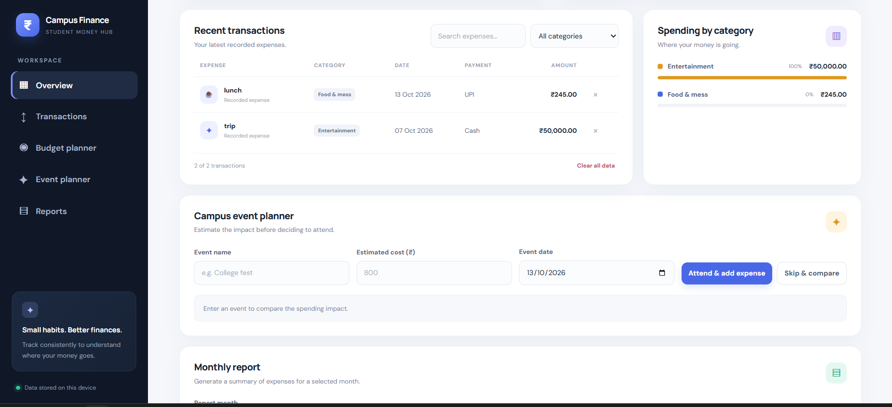
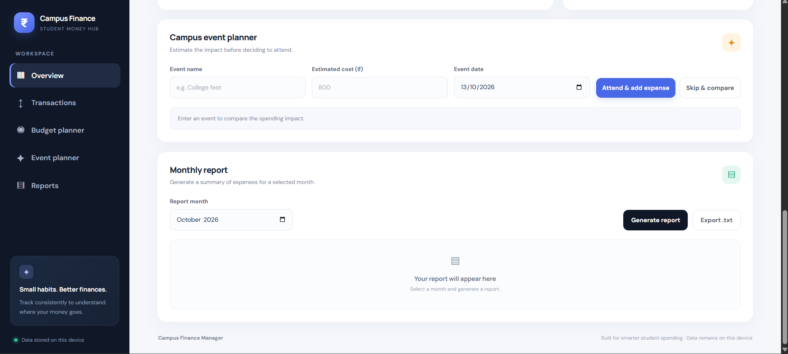
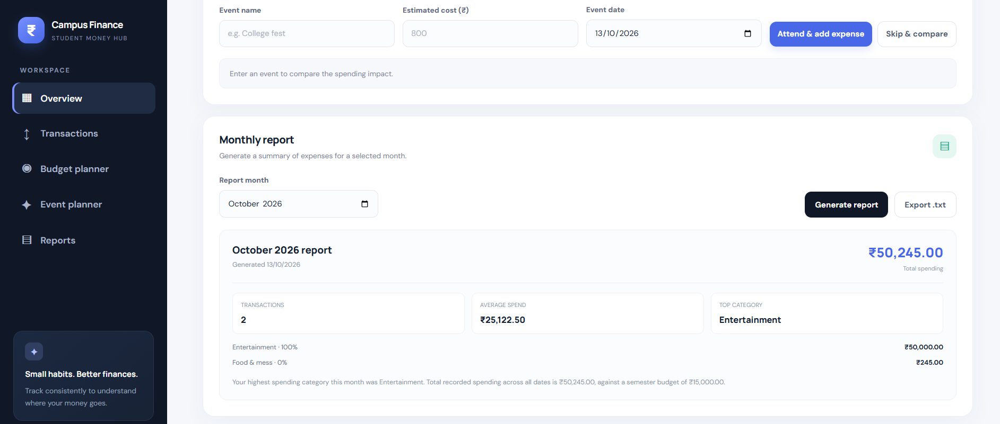

# Campus Finance Manager

[**🌐 Live Demo**](https://pranathibopparaju006.github.io/campus-finance-manager/) | [**GitHub Repository**](https://github.com/pranathibopparaju006/campus-finance-manager)

Try the live application to track expenses, manage your semester budget, plan campus events, and generate monthly reports.
A responsive, browser-based finance dashboard designed to help college students record expenses, monitor a semester budget, compare campus-event costs, and generate monthly spending reports.

> \\\\\\\\\\\\\\\*\\\\\\\\\\\\\\\*Project scope:\\\\\\\\\\\\\\\*\\\\\\\\\\\\\\\* This version is a client-side web application. Data is stored in the current browser using `localStorage`; it does not include a server, account system, or cross-device sync.

## Features

* **Expense tracking:** Record amount, description, category, date, and payment method.
* **Dashboard metrics:** View total spending, transaction count, remaining semester balance, and top spending category.
* **Budget monitoring:** Set a semester budget and receive progress and overspending warnings.
* **Transaction management:** Search and filter transactions and delete individual entries.
* **Category analytics:** Compare spending by category with proportional visual bars.
* **Campus event planner:** Estimate the cost of attending or skipping an event; attending adds an expense.
* **Monthly reports:** Select a month and review totals, average transaction, category breakdown, and insights.
* **Text export:** Export a generated monthly report as a `.txt` file.
* **Local persistence:** Expenses and budget are retained across refreshes in the same browser.
* **Responsive layout:** Desktop, tablet, and mobile-friendly interface.
* **Input validation:** Checks positive and bounded monetary amounts, required text, valid calendar dates (including impossible dates), valid categories, and report month values.

## Quality and safety checks

* Strict calendar-date validation rejects impossible dates such as February 30.
* Monetary inputs are checked against the limits shown by the app before saving.
* User-provided text is HTML-escaped before being inserted into rendered tables and reports.
* Report object URLs are released after the browser has a chance to start the download.
* All information remains in this browser; clearing browser storage or using another browser/device may remove or hide the saved data.

## Technology stack

* HTML5
* CSS3 (responsive layout, CSS variables, media queries)
* Vanilla JavaScript (DOM events, data aggregation, validation)
* Browser `localStorage`
* No build step or package installation required

## Run locally

1. Download or clone this repository.
2. Open `index.html` in a modern browser.

For a local development server, you can use VS Code's Live Server extension or run:

```bash
python -m http.server 8000
```

Then visit `http://localhost:8000`.

## How to use

1. Add expenses with a description, amount, category, date, and payment method.
2. Set a semester budget to view the remaining balance and usage percentage.
3. Use search and category filters to find a transaction.
4. Enter a campus event and estimated cost. Choose **Attend \& add expense** to record it, or **Skip \& compare** to view the estimated savings.
5. Choose a month and generate a report. Export it as a text file if needed.

## Data and privacy

This project saves data in the browser profile on the device where it is used. Clearing browser storage or switching browsers/devices may remove or hide saved entries. Do not use this demo to store sensitive financial information. It does not connect to a bank account or verify transactions.

## Project structure

```text
campus-finance-manager/
|-- index.html
|-- style.css
|-- script.js
|-- README.md
\\\\\\\\\\\\\\\\-- screenshots/
## Screenshots

### Dashboard


### Spending by Category


### Campus Event Planner


### Monthly Report


## Future improvements

\\\* Backend API and database persistence
\\\* Authentication and user-specific accounts
\\\* PDF/CSV export
\\\* Automated unit and end-to-end tests
\\\* More detailed charts and recurring expenses
\\\* Deployment with a public demo URL

## Author

Built by \\\*\\\*Pranathi\\\*\\\*.


